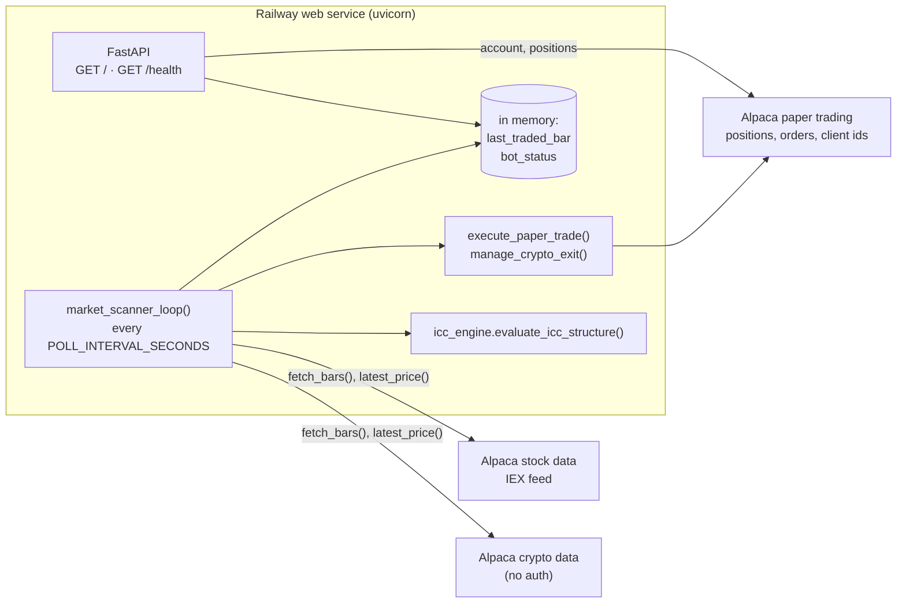
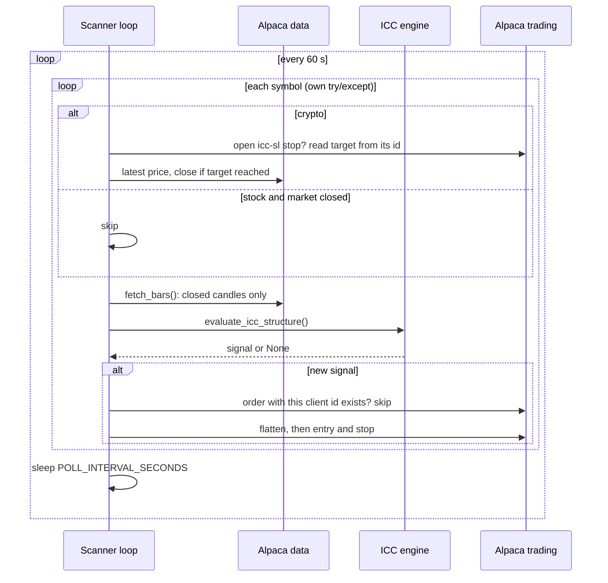

# Architecture

One Python process. FastAPI serves two routes, and its `lifespan` hook checks the Alpaca keys and then runs the scanner as an `asyncio` task in the same process. There is no database: what must survive a restart lives on Alpaca, as order ids ([[Trade Execution]]).

## One scan

Alpaca's SDK is blocking, so each symbol's scan runs through `asyncio.to_thread`, which keeps the routes responsive.

## Pieces

| Piece | Where | Note |
| --- | --- | --- |
| Startup | `lifespan` | `get_account()` first: bad keys fail the deploy |
| Scanner loop | `market_scanner_loop`, `scan_symbol` | An error in one symbol is logged and stored in `last_error`; the others still run |
| Data | `fetch_bars`, `latest_price` | [[Market Data]] |
| Signal logic | `icc_engine.py` | [[Signal Engine]] |
| Orders | `execute_paper_trade`, `flatten`, `manage_crypto_exit` | [[Trade Execution]] |
| Routes | `status`, `health` | [[Status Endpoint]] |
| Duplicate guard | `last_traded_bar` in memory, then the entry's `client_order_id` on Alpaca | Survives restarts |
| Caches | `_assets` (per symbol), `_clock` (60 s) | Fewer API calls |
