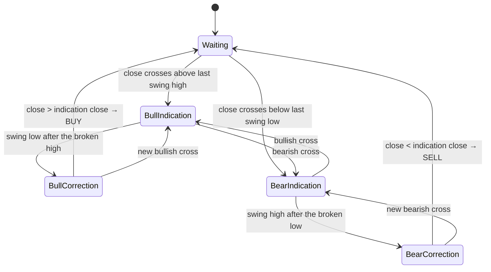

# Signal Engine

`icc_engine.py` is a bar-by-bar port of the [[Pine Script Reference|Pine indicator]] (`Source Code.txt`). It has two functions:

```python
icc_signals(df, left=3, right=3, min_tick=0.0) -> list[dict]          # every alert over the whole history
evaluate_icc_structure(df, left=3, right=3, min_tick=0.0) -> dict | None  # the alert on the last candle, if any
```

`df` needs `timestamp`, `high`, `low`, `close` columns of **closed candles**, oldest first ([[Market Data]] supplies them). `icc_signals` runs over every row the way TradingView runs the indicator over a chart; the live bot calls `evaluate_icc_structure` on the last 300 candles, and the [[Backtest]] uses `icc_signals`. With `left == right` it is the indicator's `swingLen` (default 3). `min_tick` is `syminfo.mintick`: the bot passes $0.01 for stocks and the asset's price increment for crypto.

## Verified against Source Code.txt (2026-11-26)

- A second, **literal** transliteration of the Pine Script (its `na` values, `var` state, `nz()`, both signal blocks, pivots as "the newest highest bar of the window") was written separately and compared with the engine on real data: GLD (7,147 candles) and BTC/USD (11,519 candles), at swing length 3 and 5. **Every alert was identical**: same bar, direction, entry, SL, and TP5 (260, 172, 423, and 299 alerts).
- The bot's 300-candle window gives the **same signals as the full history**: 0 differences in 176 GLD signals over a year, for windows of 300 to 2,000.

## Each bar, in the indicator's order

1. **Swings** (`ta.pivothigh(high, swingLen, swingLen)` / `ta.pivotlow`). The bar `p = t − right` is a swing high if its high is **above every bar on its right** and **at least equal to every bar on its left**: with equal highs, the newest one is the pivot. Lows likewise. This is the tie rule of [PyneCore](https://github.com/PyneSys/pynecore), a Python Pine runtime that aims to match TradingView exactly. A swing updates `last_high` / `last_low` and the bar it sits on.
2. **Indication.** If this close crosses above `last_high` (`close > last_high` and the previous close `<= last_high`): state **1**, `indication_high = close`. A cross below `last_low`: state **3**, `indication_low = close`. Either clears any correction in progress.
3. **Correction.** In state 1, the first swing low that sits **after** the broken swing high's bar: state **2**, `correction_low` = that low. Mirror for state 3 → **4** with a swing high.
4. **Continuation.** In state 2, `close > indication_high` → **BUY**; in state 4, `close < indication_low` → **SELL**. Only if the risk (entry to correction) is above `min_tick` does the alert fire and the state reset to 0. Otherwise the setup stays armed and a later close can fire it, as in the Pine Script.



There is no invalidation: a setup waits until it triggers or a new cross replaces it, as in the indicator.

## Signal

```python
{
  "action": "BUY",                         # or "SELL"
  "bar": 299,                               # its row in df
  "timestamp": "2026-11-25T14:45:00+00:00", # start of the continuation candle
  "Entry": 97123.5,                         # its close
  "SL": 96010.2,                            # the correction swing, no buffer
  "TP1": ..., "TP2": ..., "TP3": ..., "TP4": ..., "TP5": ...  # Entry ± risk × 1..5
}
```

Prices are rounded to 6 decimals. The capitalised keys are the field names of the indicator's alert text ([[History]]).

## Tests

`tests/test_icc_engine.py` builds small flat-candle series whose swings can be traced by hand: a BUY, its mirror SELL, an indication with no continuation, a signal on an older bar, a continuation that beats the swing but not the indication close, equal highs on the left (still a swing) and on the right (no swing), risk not above `min_tick` (the setup stays armed), and too few bars.

```bash
.venv/bin/python -m unittest
```

## What can still differ from your chart

The logic matches; the **prices** may not. See [[Pine vs Python Differences]].
