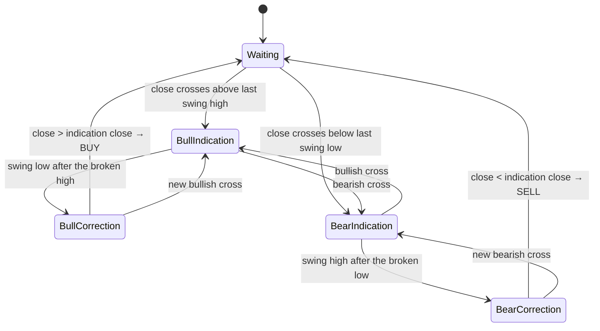

# Signal Engine

`icc_engine.py` is a bar-by-bar port of the [[Pine Script Reference|Pine indicator]]. It has one public function:

```python
evaluate_icc_structure(df, left=3, right=3, min_tick=0.0) -> dict | None
```

`df` needs `timestamp`, `high`, `low`, `close` columns of **closed candles**, oldest first ([[Market Data]] supplies them). It replays the whole window on every call and returns a signal only if the **last row** is the continuation candle. It keeps no state between calls. With `left == right` it is the indicator's `swingLen`; the defaults (3, 3) match the indicator's default.

It returns `None` when there are fewer than `left + right + 2` rows.

## Each bar, in the indicator's order

1. **Swings.** The bar `p = t − right` is a swing high if its high is the unique maximum of `[p − left, p + right]`, and likewise for swing lows. A swing found this way updates `last_high` / `last_low` and the bar it sits on.
2. **Indication.** If this close crosses above `last_high` (`close > last_high` and the previous close `<= last_high`): state **1**, `indication_high = close`. A cross below `last_low`: state **3**, `indication_low = close`. Either clears any correction in progress.
3. **Correction.** In state 1, the first swing low that sits **after** the broken swing high's bar: state **2**, `correction_low` = that low. Mirror for state 3 → **4** with a swing high.
4. **Continuation.** In state 2, `close > indication_high` → **BUY**; in state 4, `close < indication_low` → **SELL**. If the risk (entry to correction) is above `min_tick`, the state resets to 0, and a signal is returned only when this is the last bar.



There is no invalidation: a setup waits until it triggers or a new cross replaces it, as in the indicator.

## Signal

```python
{
  "action": "BUY",                         # or "SELL"
  "timestamp": "2026-11-25T14:45:00+00:00", # start of the continuation candle
  "Entry": 97123.5,                         # its close
  "SL": 96010.2,                            # the correction swing, no buffer
  "TP1": ..., "TP2": ..., "TP3": ..., "TP4": ..., "TP5": ...  # Entry ± risk × 1..5
}
```

Prices are rounded to 6 decimals. The capitalised keys are the field names of the indicator's alert text ([[History]]).

## Tests

`tests/test_icc_engine.py` builds small flat-candle series whose swings can be traced by hand: a BUY, its mirror SELL, an indication with no continuation, a signal on an older bar, a continuation that beats the swing but not the indication close, and too few bars.

```bash
.venv/bin/python -m unittest
```

## Limits of the port

- **Ties.** A swing must be the unique extreme of its window. Pine's tie handling for equal highs may differ; it rarely matters on crypto and stock prices.
- **Warm-up.** The indicator sees the chart's whole history; the engine sees `LOOKBACK_BARS` (300). The state at the last bar can differ when a setup started before the window. With 300 bars that is rare.
- **Data.** Alpaca's candles are not TradingView's ([[Market Data#Why the chart may still differ]]).
